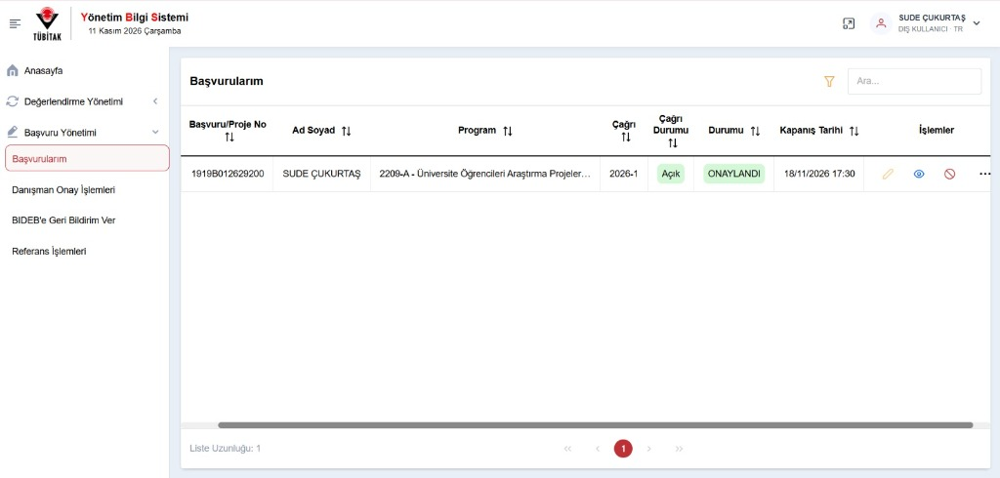

# Yan Görev 4 — TÜBİTAK 2209-A Başvurusu Teslimi

- **Program:** TÜBİTAK 2209-A Üniversite Öğrencileri Araştırma Projeleri Destekleme Programı (2026/1 Çağrısı)
- **Başvuru / Proje No:** `1919B012629200`
- **Proje Yürütücüsü:** Sude Çukurtaş (@sudecukurtas)
- **Proje Ekibi / Araştırmacılar:**
  - Sude Çukurtaş (@sudecukurtas) — Yürütücü
  - Dilara Başer (@baserdilara94-ui) — Araştırmacı
  - Ece Naz (@ece-naz) — Araştırmacı
- **Başvuru Durumu:** **ONAYLANDI** (Danışman Onayı Tamamlandı)
- **Kapanış Tarihi:** 18/11/2026 17:30
- **İlgili Issue Kayıtları:**
  - Grup G: [#65](https://github.com/MAKU-VBA-GBT-II/group-g/issues/65)
  - Grup B: [#66](https://github.com/MAKU-VBA-GBT-II/group-b/issues/66)

## Kanıt Belgesi (TYBS Ekran Görüntüsü)

